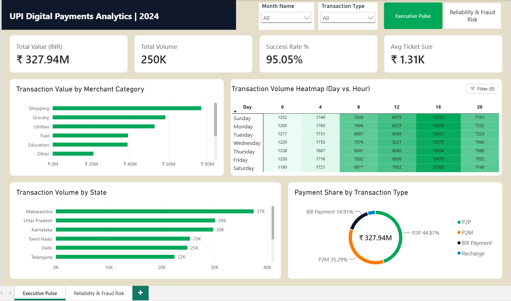
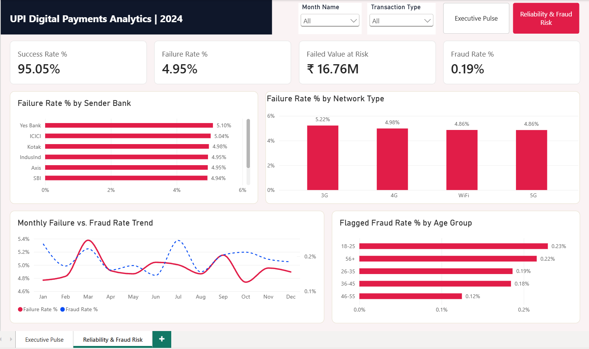

# UPI Digital Payments Analytics | 2024 (Power BI)

An interactive two-page Power BI executive dashboard analyzing **250,000 UPI transactions (₹327.94M total value)** across India in 2024 to surface transaction velocity, payment category shares, network failure bottlenecks, and flagged fraud patterns.

## Dashboard Preview

### Page 1 — Executive Pulse

### Page 2 — Reliability & Fraud Risk

## Key Insights
* **Transaction Scale:** **₹327.94M** processed across **250K** transactions with an average ticket size of **₹1.31K** and a **95.05%** overall success rate.
* **Payment & State Concentration:** **P2P (44.87%)** and **P2M (35.29%)** account for **80.16%** of total value, led by **Shopping**, **Grocery**, and **Utilities**, with **Maharashtra (37K)**, **Uttar Pradesh (30K)**, and **Karnataka (30K)** driving top state volume.
* **Peak Rush Window:** The Day × 4-Hour matrix shows volume surging consistently during the **16:00–20:00 (4 PM – 8 PM)** window across all seven days (peaking on Monday at **10,814** transactions).
* **Failure & Fraud Exposure:** A **4.95%** failure rate places **₹16.76M** at risk, with **3G networks (5.22%)** showing higher failure rates than **5G/WiFi (4.86%)**. Flagged fraud sits at **0.19%**, led by the **18–25 (0.23%)** and **56+ (0.22%)** age cohorts.

## Data Modeling & Technical Implementation
* **Star Schema:** Fact table (`upi_transactions_2024`) linked to a dedicated DAX `Calendar` dimension table with chronological month and weekday sorting.
* **DAX Measures (`_Measures`):** Custom measures built with `CALCULATE`, `DIVIDE`, and `SUMX` for `Total Value (INR)`, `Total Volume`, `Success Rate %`, `Failure Rate %`, `Failed Value at Risk`, `Avg Ticket Size`, and `Fraud Rate %`.
* **UX & Visual Design:** Responsive `1280 × 720` layout with synced global slicers (`Month Name`, `Transaction Type`), 4-hour binned heatmap columns, dual-axis trend analysis, and state-aware page navigation switching between **Growth (`#00A859`)** and **Risk (`#E11D48`)** themes.

## Repository Structure
* `UPI_Digital_Payments_2024.pbix` — Complete Power BI Desktop report
* `upi_transactions_2024.csv` — Cleaned 250,000-row dataset
* `01_executive_pulse.png` / `02_reliability_fraud_risk.png` — Dashboard exports
